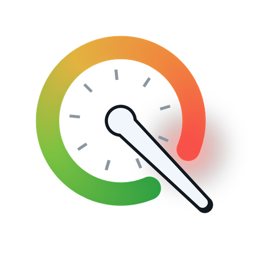

<p align="center"></p>

# metriQ

A compact always-on-top dashboard for Windows that shows live sensor data: clocks, usage, power, temperatures, fans,
network/disk throughput and FPS, each with a colour gradient (green to red), a bar, and panel-side MIN / MAX / AVG.
It can also record the values to CSV files. Made for a small secondary or portrait monitor, but it runs happily on any
screen (window, maximized or full screen).

The data comes from one of three sources: [HWiNFO](https://www.hwinfo.com/) (widest coverage),
[LibreHardwareMonitor](https://github.com/LibreHardwareMonitor/LibreHardwareMonitor) (open source), or the
**built-in** Windows sources (nothing to install, but no CPU temperatures / fans). See [Data sources](#data-sources).

> Not affiliated with, endorsed by, or sponsored by HWiNFO / REALiX s.r.o. or the LibreHardwareMonitor project.

## ⬇ Download

**[Download the latest Setup (metriQ-Setup.exe)](../../releases/latest)** — Windows 10 / 11, no Python needed.

1. Run the Setup. It checks for HWiNFO and offers to install it for you (free, via winget) and to turn on its
   *Shared Memory Support*. You can skip it: the panel then uses its built-in data source.
2. Start **metriQ** from the Start menu. It starts HWiNFO with it and closes it again when you close the panel.
3. Press the ⚙ gear (or **S**) for settings: language, monitor, 1–3 columns, rows, colours, logging.

The Setup is not code-signed yet, so Windows SmartScreen may show *"Windows protected your PC"*: click
*More info → Run anyway*. Details, the portable zip and running from source: see [Install](#install).
Signing: see the [Code signing policy](#code-signing-policy).

**Türkçe:** [En son Setup'ı indir](../../releases/latest) → çalıştır (HWiNFO yoksa kurmayı teklif eder) → Başlat
menüsünden **metriQ**'i aç. Ayarlar için ⚙ ya da **S**. Ayrıntılar: [Türkçe](#türkçe).
> HWiNFO is a trademark of its owner. This project only *reads* the sensor data that HWiNFO publishes through its
> documented shared memory interface (or that LibreHardwareMonitor publishes through its local web server).

Türkçe açıklama için aşağıya bakın: [Türkçe](#türkçe).

## Features

- Layout built **automatically from your hardware** (per-core CPU clocks for AMD and Intel incl. P-/E-cores, CPU
  usage / power / temperatures, GPU NVIDIA / AMD / Intel, RAM / VRAM, motherboard VRM / PCH temps, all motherboard
  fans, drive temperatures, network of the busiest adapter, disk read/write, PresentMon FPS). Rows that do not exist
  on your PC are simply left out.
- Fully **configurable** (`config.json`): sections, rows, regex matching on the *original English* sensor names,
  number formats, units, colour limits, bars. Each data source keeps its own layout.
- 256-step green to red colour gradient per row from its limits (reversed limits for FPS: low = red).
- **CSV logging**: every on/off session writes a new file; "required rows" or "all sensors" (slide switch);
  interval 0.5 to 30 s (spin box in the panel). Press `L` to toggle recording, `S` for settings, `F11` for full screen.
- Optional (after `scripts\install.ps1`): the panel **starts HWiNFO when it opens and stops it when it closes**, writes the
  logging interval to HWiNFO's `SensorInterval`, and restarts HWiNFO automatically when the shared memory is gone for
  more than 20 s (the free HWiNFO version stops its sensors after 12 hours). Without this the panel runs in read-only
  mode and shows a hint when HWiNFO is not running.
- **Settings window** (gear button next to the interval box, or press `S`): language, columns, monitor, window mode,
  always on top, logging, CSV format, data source and HWiNFO options, and the layout itself (show /
  hide rows, names, colour limits, bars, section titles / colours / order, "Add sensor" from the live sensor list).
  Changes apply live. The *Data source* tab also lists which data the active source cannot provide, and why.
- **Mini mode**: a small semi-transparent strip with a few readings (FPS, CPU / GPU temperature, usage, power by
  default) on top of your game, toggled by a global hotkey (`Ctrl+Shift+M`) or `M` on the panel, see [Mini mode](#mini-mode-in-game-overlay).
- **Multi-column layout** for wide screens: sections are distributed over 1 to 3 columns (automatic by window shape).
- **Updates**: the panel checks GitHub for a newer release and, after you confirm, downloads and installs it
  (checksum verified); can be turned off in Settings.
- English and Turkish UI (follows the Windows display language by default).
- Pure Python standard library; no packages to install (`psutil` is an optional fallback, see below).

## Requirements

- Windows 10 / 11
- Only for running from source: Python 3.10+ with tkinter (python.org installer, or the Microsoft Store version). Check:
  `python -c "import tkinter"`. The Setup / portable zip bundle their own Python.
- One data source (see the next section). For HWiNFO: [HWiNFO64](https://www.hwinfo.com/download/) with
  **Settings > "Shared Memory Support" enabled** (in the Sensors window settings). The free version limits the shared
  memory to **12 hours** per start; with the installed tasks the panel restarts HWiNFO for you, otherwise restart it
  yourself.

## Data sources

| | HWiNFO | LibreHardwareMonitor | Built-in |
|---|---|---|---|
| Install | HWiNFO64 (free / Pro) | LHM (open source, MPL-2.0) | nothing |
| Needs admin rights | yes (HWiNFO runs elevated) | yes (LHM runs elevated) | no |
| CPU usage, per-core clocks, RAM | ✓ | ✓ | ✓ (clocks as estimated by Windows) |
| CPU temperatures, CPU power, voltages | ✓ | ✓ | ✗ |
| Motherboard VRM / PCH temperatures, fans | ✓ | ✓ (most Super I/O chips) | ✗ |
| GPU temperature, clock, load, power, fan, VRAM | ✓ | ✓ | NVIDIA: ✓ (NVML) · AMD: ✓ (ADL, Overdrive 8 cards) · Intel: load and VRAM only |
| GPU hot spot / memory junction | ✓ | ✓ (most GPUs) | ✗ |
| Drive temperatures | ✓ | ✓ | ✗ |
| Network, disk throughput | ✓ | ✓ | ✓ |
| FPS | ✓ (HWiNFO's PresentMon) | optional, PresentMon (experimental) | optional, PresentMon (experimental) |
| Panel starts / stops it, interval sync, auto restart | ✓ (with `scripts\install.ps1`) | – | – |

CPU temperatures, fans, voltages and CPU power can only be read through a **signed kernel driver**: that is what
HWiNFO and LibreHardwareMonitor install. Windows itself does not expose them to normal programs, so the built-in source
cannot show them; the panel says so in the settings window.

Choose the source in **Settings > Data source** (or `"backend"` in `config.json`):

* `auto` (default): HWiNFO if its shared memory is there (or if the panel is set up to start HWiNFO itself), otherwise
  LibreHardwareMonitor if it is reachable, otherwise built-in. The panel switches up to HWiNFO / LHM as soon as they
  appear, and falls back when they stay gone (15 s; 90 s when the panel manages HWiNFO).
* `hwinfo`, `lhm`, `builtin`: always that one.

**LibreHardwareMonitor:** start it (as administrator) and enable **Options > Remote Web Server > Run** (port 8085).
The panel reads `http://127.0.0.1:8085/data.json` (`lhm_url` to change it). If the web server is off, it falls back to
the WMI namespace `root\LibreHardwareMonitor` (only in LHM versions that still provide it). *Status: the LHM source
is implemented and tested against LHM's documented `data.json` / WMI formats with synthetic data, but not yet against a
running LibreHardwareMonitor; please report problems.*

**Built-in:** Windows performance counters (English counter names, any Windows language), `GlobalMemoryStatusEx`,
NVML (`nvml.dll`, installed with every NVIDIA driver) and ADL (`atiadlxx.dll`, installed with the AMD driver) through
`ctypes`: no package and no admin rights needed.
Optional (source installs): `pip install psutil` is used only if the Windows performance counters are broken (then repair them with
`lodctr /r` as administrator, or install psutil for CPU / network / disk data).

**FPS without HWiNFO (optional, experimental):** download Intel's
[PresentMon](https://github.com/GameTechDev/PresentMon/releases) console application and set its path in
Settings > Data source (`presentmon_path`). It measures the application in the foreground window. PresentMon needs
administrator rights or membership in the Windows group *Performance Log Users*. *Status: implemented, not yet tested
with a real PresentMon.*

## Mini mode (in-game overlay)

A small borderless strip that shows up to 8 rows of your layout (default: FPS, CPU temperature, CPU usage, GPU
temperature, GPU usage, GPU power, where they exist) in the same colours as the panel. Settings > **Mini mode**:
hotkey, corner + X / Y offset, monitor, horizontal / vertical, opacity (30 - 100 %), font size, labels on / off, a plate
or a transparent background, the metric list, and "show when metriQ starts" (off by default).

- It is click-through, never takes the keyboard focus, has no taskbar / Alt+Tab entry and is put back on top every 2 s,
  so it does not disturb the game. Toggle it with the global hotkey (`Ctrl+Shift+M` by default; `Ctrl+Alt+M`,
  `Ctrl+Shift+F10` or off) or press `M` on the panel. If another program already owns the hotkey, the panel says so.
- **Limitation: it works over games in windowed or borderless ("fullscreen windowed") mode only.** A game in
  *exclusive fullscreen* is drawn above every other window, so the strip is hidden there; switch the game to borderless.
- It is an ordinary window of the metriQ process: nothing is injected into any game (no DLLs, no hooks), so it is
  safe with anti-cheat systems. The values are the panel's own, read with the same interval.

## Install

**Option 1 - Setup (recommended, no Python needed).** Download `metriQ-Setup-<version>.exe` from the
[Releases](../../releases) page and run it. It installs to `%ProgramFiles%\metriQ`, adds a Start Menu shortcut
(optional desktop icon, optional "start with Windows") and, if HWiNFO64 is found, registers the three scheduled tasks
`\metriQ\Start`, `Stop`, `SetInterval` (needs administrator rights, asked once) so the panel can start / stop
HWiNFO and change its polling interval without a UAC prompt each time. The interval file the tasks read lives in
`%ProgramData%\metriQ`. Without HWiNFO64 the panel still works in read-only mode (install HWiNFO and run the
Setup again). English and Turkish wizard. Uninstall from *Settings > Apps*; it removes the tasks and the program folder
and keeps your settings and logs in `%LOCALAPPDATA%\metriQ`. An older `config.json` written by the Store-Python
source version is taken over on first start.

**Option 2 - portable zip.** Unzip `metriQ-<version>-portable.zip` anywhere and run `metriQ.exe`
(read-only mode, no tasks; set `METRIQ_DIR` to keep the settings next to it).

**Option 3 - from source** (Python 3.10+ with tkinter):

1. Download / clone this folder anywhere (it is used in place, do not delete it afterwards).
2. Enable *Shared Memory Support* in HWiNFO.
3. In PowerShell, in this folder:

   ```powershell
   powershell -ExecutionPolicy Bypass -File scripts\install.ps1
   ```

   * creates the Start Menu shortcut **metriQ** (with its own taskbar icon),
   * asks once for administrator rights (UAC) to copy `hidden.vbs` and `set_interval.ps1` to
     `%ProgramFiles%\metriQ` and to register three scheduled tasks
     `\metriQ\Start`, `Stop`, `SetInterval`. They let the panel start/stop HWiNFO (which itself needs
     administrator rights) without a UAC prompt each time. Use `-NoTasks` to skip this part.
   * `-HwinfoPath "D:\Tools\HWiNFO64\HWiNFO64.EXE"` if your HWiNFO is not found automatically.

   You can also skip the installer completely: `pythonw src\panel.py` (or `python src\panel.py`) works, in read-only mode.

4. Start **metriQ** from the Start Menu.

> **Unsigned builds:** the release files are not code-signed yet, so Windows SmartScreen may show "Windows protected
> your PC / unknown publisher" (click *More info* > *Run anyway*), and **Smart App Control**, if enabled on your PC,
> may block the unsigned `.exe` completely (running from source with Python is the alternative).

**Build locally** (Python 3.10+ with tkinter; PyInstaller is installed into `build\venv` only):

```powershell
powershell -ExecutionPolicy Bypass -File packaging\build.ps1               # dist\metriQ\metriQ.exe
powershell -ExecutionPolicy Bypass -File packaging\build.ps1 -Zip -Installer   # + portable zip and Setup (needs Inno Setup 6)
```

The Setup is described by `packaging\setup.iss` (compiled to `packaging\Output`, and the Setup exe is copied to the repo root); the version comes from `src\version.py`.
Pushing a tag `v*` builds and publishes both files via GitHub Actions (`.github/workflows/release.yml`).

Uninstall (source install): `powershell -ExecutionPolicy Bypass -File scripts\uninstall.ps1` removes the tasks, the Program Files folder and the
shortcut and keeps your settings and logs; add `-Purge` to delete them as well.

Security note: the tasks run only the two files in `%ProgramFiles%\metriQ` (writable by administrators only).
The only user-writable input is a text file containing the interval, which is accepted only as an integer
(clamped to 250 to 60000 ms).

## Files and settings

Everything personal lives in `%LOCALAPPDATA%\metriQ\` (created on first run, never part of the repository):

| File | Purpose |
|---|---|
| `config.json` | your settings and (optionally) your layout |
| `logs\` | CSV recordings (default folder, see `log_dir`) |
| `hwinfo_interval.txt` | interval handed to the `SetInterval` task (Setup installs use `%ProgramData%\metriQ\hwinfo_interval.txt` instead) |
| `panel.log` | traceback if the panel crashed at start |

Set the environment variable `METRIQ_DIR` to use another folder (portable use; `HWINFO_PANEL_DIR`, the name before
v1.2.0, still works).

### config.json

| Key | Values | Meaning |
|---|---|---|
| `backend` | `"auto"`, `"hwinfo"`, `"lhm"`, `"builtin"` | data source, see [Data sources](#data-sources) |
| `language` | `"auto"`, `"tr"`, `"en"` | UI language (`auto` = Windows display language) |
| `monitor` | `"auto"` or index | `auto` = first non-primary portrait monitor, otherwise the primary one. Indexes: `python tools\list_monitors.py` |
| `window_mode` | `"maximized"`, `"fullscreen"`, `"window"` | how the window is placed on that monitor |
| `columns` | `"auto"`, `1`, `2`, `3` | number of columns; `auto` = 1 on a portrait window, otherwise 3 if width / height is 2.0 or more, else 2. Whole sections are distributed in order, a section is never split |
| `topmost` | `true` / `false` | keep the window on top |
| `check_updates` | `true` / `false` | check GitHub for a newer release at start and every 24 h (see [Privacy](#privacy)) |
| `interval` | 0.5 to 30 | CSV logging interval in seconds |
| `logging` | `true` / `false` | recording on/off (also toggled in the panel) |
| `log_all` | `true` / `false` | `false` = only the rows shown, `true` = every sensor reading of the source |
| `log_dir` | path or `""` | CSV folder; `""` = `%LOCALAPPDATA%\metriQ\logs` |
| `csv_delimiter`, `csv_decimal` | `"auto"` or a character | `auto` uses the Windows list separator / decimal symbol so Excel opens the file correctly |
| `sync_hwinfo_interval` | `true` / `false` | also set HWiNFO's polling interval to `interval` (needs the installed tasks; HWiNFO source only) |
| `manage_hwinfo` | `true` / `false` | start HWiNFO with the panel, stop it on close (needs the installed tasks; HWiNFO source only) |
| `hwinfo_path` | `"auto"` or path | location of `HWiNFO64.EXE` (auto: registry, then `%ProgramFiles%\HWiNFO64`) |
| `lhm_url` | `"auto"` or URL | LibreHardwareMonitor web server (`auto` = `http://127.0.0.1:8085/data.json`) |
| `presentmon_path` | `""` or path | PresentMon console exe for FPS with the LHM / built-in source (`""` = off) |
| `bench_ssd_drive` | `"auto"` or `"D:"` | drive of the SSD benchmark file (`"auto"` = the Temp folder's drive) |
| `minimode` | object | the in-game strip, see [Mini mode](#mini-mode-in-game-overlay): `enabled`, `hotkey` (`"ctrl+shift+m"`, `"ctrl+alt+m"`, `"ctrl+shift+f10"`, `"off"`), `corner` (`tl` `tr` `bl` `br`), `x`, `y`, `monitor` (`"primary"` or index), `orientation`, `opacity`, `font_size`, `labels`, `background` (`"plate"` / `"none"`), `metrics` (`"auto"` or a list). Missing keys use the defaults |
| `sections` | `"auto"` or a list | the layout of the HWiNFO source, see below |
| `sections_lhm`, `sections_builtin` | `"auto"` or a list | the layouts of the other sources (missing = `auto`) |

### Customising the layout

With `"sections": "auto"` the layout is detected from your sensors each time the panel starts. To edit it, write the
detected layout into `config.json`:

```
python tools\export_layout.py                     # data source from config.json
python tools\export_layout.py --backend builtin   # or hwinfo / lhm
```

and change the `sections` list, or use the layout tab of the settings window (it writes the same list; "Reset to
auto layout" sets `"sections": "auto"` again). If none of your rows exists on a PC, the panel falls back to auto-detection.
The sources name their sensors differently, so each one has its own key: `sections` (HWiNFO), `sections_lhm`,
`sections_builtin`; the settings window always edits the layout of the active source.

```json
"sections": [
  {
    "title": "TEMPERATURES",
    "color": "#ff7b72",
    "icon": "temp",
    "rows": [
      { "name": "GPU", "sensor": "^dGPU \\[#0\\]", "label": "^GPU Temperature", "type": 1,
        "format": "{:.0f}", "unit": "°C", "limits": [30, 88], "bar": true },
      { "name": "Case fan", "sensor": "Super-I/O", "label": "^System 1$", "type": 3,
        "format": "{:.0f}", "unit": "RPM", "limits": [300, 1800] }
    ]
  }
]
```

* `icon`: `gauge`, `bolt`, `temp`, `fan`, `net`, `fps`. `color`: any `#rrggbb`.
* `sensor`, `label`: **case-insensitive regular expressions** (`re.search`) matched against the
  **original English** sensor and reading names, so a layout works with any HWiNFO / Windows language. `sensor` is
  optional. The built-in source uses HWiNFO's names (`CPU [#0]: …` / `Total CPU Usage`, `GPU [#0]: …` /
  `GPU Temperature` …); LibreHardwareMonitor keeps its own reading names (`Core (Tctl/Tdie)`, `CPU Total`, `Package` …)
  with HWiNFO-style sensor prefixes (`CPU [#0]: `, `GPU [#0]: `, `System: `, `Network: `, `Drive: `, `S.M.A.R.T.: `). The first matching reading wins. `type` (optional): 1 temp, 2 voltage, 3 fan, 4 current, 5 power,
  6 clock, 7 usage, 8 other.
* `format`: Python format for the number, e.g. `"{:.1f}"`. `unit`: text shown (default: HWiNFO's unit).
* `visible` (row, optional, default `true`): `false` hides the row (not shown, not logged in "required" mode) but keeps
  it in the file; the settings window sets it.
* `limits`: `[green_value, red_value]`: the colour moves from green to red between them (a bigger green value than
  red value reverses it, as for FPS). Without `limits` the row has no bar / gradient. `bar`: `false` hides the bar.
* To find the names on your PC: `python tools\list_sensors.py` (optionally with filter words:
  `python tools\list_sensors.py gpu temp`, or another source: `--backend builtin`). The output may contain serial
  numbers; do not post it publicly. `python tools\check_layout.py [--backend …]` checks that every row finds a reading.

### CSV format

One file per recording session: `YYYY-MM-DD_HH-MM-SS.csv` in `log_dir`, UTF-8 with BOM, first column the time stamp,
then one column per row ("name (unit)") or, in "all data" mode, one column per reading of the source
("sensor | label [unit]"). Delimiter and decimal symbol follow your Windows regional settings by default
(e.g. `;` and `,` in Turkish / German Excel).

### Privacy

This program will not transfer any information to other networked systems unless specifically requested by the
user or the person installing or operating it.

Everything stays on your PC. The panel reads HWiNFO's local shared memory, LibreHardwareMonitor's web server on
this PC (`127.0.0.1` by default) or Windows' own counters, and writes only the files above. The only network
access is the optional HWiNFO download during Setup (via winget, only when you tick "Also install HWiNFO64").
HWiNFO and LibreHardwareMonitor are separate programs with their own privacy policies.

Update check: at start and then every 24 hours the panel asks GitHub (`api.github.com`) whether a newer release
exists. Only the public release information is requested; no personal or sensor data is sent. You can turn this off
in Settings (*Appearance*: "Check for updates automatically", or `"check_updates": false`). A new version is
downloaded and installed only after you confirm it, and only if its SHA-256 checksum matches the one GitHub
publishes for the file.

## Code signing policy

Free code signing provided by [SignPath.io](https://about.signpath.io), certificate by [SignPath Foundation](https://signpath.org).

Signed files are built automatically by GitHub Actions ([release workflow](.github/workflows/release.yml)) from the
source code in this repository; every signing request is approved manually.

| Role | Members |
|---|---|
| Committers and reviewers | [AcarPlus](https://github.com/AcarPlus) |
| Approvers | [AcarPlus](https://github.com/AcarPlus) |

Until signing is in place, releases are unsigned (see the SmartScreen note above).

## Troubleshooting

* "HWiNFO is running but shared memory is off": enable *Shared Memory Support* in HWiNFO's settings and restart it.
* "LibreHardwareMonitor not reachable": start LHM and enable *Options > Remote Web Server > Run*.
* No CPU temperature / fans with the built-in source: expected, see [Data sources](#data-sources).
* Values freeze every 12 hours with the free HWiNFO: install the tasks (`scripts\install.ps1`) for automatic restart.
* Wrong monitor: `python tools\list_monitors.py`, then set `"monitor"`.
* Python icon instead of the panel icon in the taskbar when started with `python src\panel.py`: use the Start Menu shortcut.
* Crash on start: see `%LOCALAPPDATA%\metriQ\panel.log`.

## Development

`backend.py` (data source selection), `hwsm.py` (HWiNFO shared memory reader), `sens_lhm.py` (LibreHardwareMonitor),
`sens_builtin.py` (built-in: PDH, NVML, DXGI), `presentmon.py` (optional FPS),
`layout.py` (rows, matching, auto-detection), `config.py` (settings, monitors),
`hwctl.py` (HWiNFO detection and tasks), `i18n.py` (strings), `panel.py` (UI), `settings_ui.py` (settings window),
`winicon.py` (taskbar identity), `version.py`, `packaging/` (PyInstaller spec, Inno Setup script, build script),
`gfx.py` (anti-aliased icons and cards; needs the optional `pip install pillow`, without it the panel draws plain canvas shapes),
`src\make_icon.py` (regenerates `metriq.ico`). License: [MIT](LICENSE).

---

## Türkçe

Canlı sensör verisi gösteren, her zaman üstte duran küçük bir Windows panosu: saat/kullanım, güç, sıcaklık, fan,
ağ/disk ve FPS; her satırda yeşilden kırmızıya renk, çubuk ve panel tarafında MİN / MAKS / ORT. İsterseniz değerleri
CSV dosyasına kaydeder. HWiNFO / REALiX veya LibreHardwareMonitor projesiyle bağlantısı yoktur.

**Gereksinimler:** Windows 10/11; Python 3.10+ (tkinter dahil; yalnızca kaynaktan çalıştırmak için); bir veri kaynağı (aşağıda). HWiNFO için: Ayarlar >
**Shared Memory Support** açık olmalı (ücretsiz sürümde paylaşılan bellek her başlatmada **12 saat** ile sınırlıdır).

**Veri kaynakları** (Ayarlar > **Veri kaynağı** veya `config.json` içinde `"backend"`):

| | HWiNFO | LibreHardwareMonitor | Yerleşik |
|---|---|---|---|
| Kurulum | HWiNFO64 | LHM (açık kaynak) | gerekmez |
| Yönetici hakkı | evet | evet | hayır |
| CPU kullanımı, çekirdek saatleri, RAM | ✓ | ✓ | ✓ (saatler Windows tahmini) |
| CPU sıcaklıkları, CPU gücü, voltajlar | ✓ | ✓ | ✗ |
| Anakart VRM / PCH sıcaklığı, fanlar | ✓ | ✓ (çoğu Super I/O) | ✗ |
| GPU sıcaklık, saat, yük, güç, fan, VRAM | ✓ | ✓ | NVIDIA: ✓ (NVML) · AMD: ✓ (ADL, Overdrive 8 kartlar) · Intel: yalnızca yük ve VRAM |
| Disk sıcaklıkları | ✓ | ✓ | ✗ |
| Ağ, disk hızı | ✓ | ✓ | ✓ |
| FPS | ✓ (HWiNFO'nun PresentMon'u) | isteğe bağlı, PresentMon (deneysel) | isteğe bağlı, PresentMon (deneysel) |
| Panelin açıp kapatması, aralık eşitleme, otomatik yeniden başlatma | ✓ (`scripts\install.ps1` ile) | – | – |

CPU sıcaklıkları, fanlar, voltajlar ve CPU gücü yalnızca **imzalı bir çekirdek sürücüsü** ile okunabilir (HWiNFO ve
LibreHardwareMonitor bunu kurar); Windows bu verileri normal programlara vermez, bu yüzden yerleşik kaynak gösteremez.
`auto` (varsayılan): HWiNFO varsa (veya panel HWiNFO'yu kendisi başlatacak şekilde kuruluysa) HWiNFO, yoksa
erişilebiliyorsa LibreHardwareMonitor, yoksa yerleşik; HWiNFO / LHM sonradan açılırsa panel onlara geçer.
**LibreHardwareMonitor:** yönetici olarak açın ve **Options > Remote Web Server > Run** seçin (port 8085); panel
`http://127.0.0.1:8085/data.json` adresini okur (yedek: WMI `root\LibreHardwareMonitor`). *Durum: LHM kaynağı
sentetik veriyle test edildi, çalışan bir LHM ile henüz denenmedi.* **Yerleşik:** Windows performans sayaçları,
`GlobalMemoryStatusEx`, NVML (`nvml.dll`, NVIDIA sürücüsüyle gelir) ve ADL (`atiadlxx.dll`, AMD sürücüsüyle gelir) `ctypes`
ile; paket gerekmez. İsteğe bağlı (kaynaktan
çalıştırırken) `pip install psutil` yalnızca Windows performans sayaçları bozuksa kullanılır. **HWiNFO'suz FPS (isteğe bağlı,
deneysel):** Intel [PresentMon](https://github.com/GameTechDev/PresentMon/releases) konsol uygulamasının yolunu
Ayarlar > Veri kaynağı'nda girin (`presentmon_path`); yönetici hakkı veya *Performance Log Users* grubu gerekir.

**Kurulum:** üç yol var. (1) **Önerilen:** [Releases](../../releases) sayfasından `metriQ-Setup-<sürüm>.exe`
dosyasını indirip çalıştırın (Python gerekmez; Türkçe/İngilizce sihirbaz). `%ProgramFiles%\metriQ` altına kurulur,
Başlat menüsü kısayolu ekler (isteğe bağlı masaüstü simgesi ve "Windows ile başlat"); HWiNFO64 bulunursa (yönetici
onayıyla, bir kez) HWiNFO'yu her seferinde UAC sormadan açıp kapatan 3 zamanlanmış görevi kurar. HWiNFO64 yoksa panel
salt okunur çalışır (HWiNFO'yu kurup Setup'ı yeniden çalıştırın). Kaldırma: Ayarlar > Uygulamalar (ayarlar ve kayıtlar
`%LOCALAPPDATA%\metriQ` altında kalır). (2) **Taşınabilir zip:** açın, `metriQ.exe` çalıştırın (görev yok,
salt okunur). (3) **Kaynaktan:** klasörü bir yere koyun, HWiNFO'da Shared Memory Support'u açın, bu klasörde
`powershell -ExecutionPolicy Bypass -File scripts\install.ps1` çalıştırın (`-NoTasks` ile görevler atlanır). Kaldırma:
`scripts\uninstall.ps1` (ayarlar ve kayıtlar kalır, silmek için `-Purge`).
**Uyarı:** sürümler henüz imzalı değildir; SmartScreen "bilinmeyen yayıncı" uyarısı gösterebilir ("Daha fazla bilgi" >
"Yine de çalıştır"), **Akıllı Uygulama Denetimi** (Smart App Control) açıksa imzasız .exe'yi tamamen engelleyebilir
(bu durumda kaynaktan çalıştırın). **Yerelde derleme:** `powershell -ExecutionPolicy Bypass -File packaging\build.ps1`
(`-Zip -Installer` ile zip ve Setup; Inno Setup 6 gerekir).

**Ayarlar:** `%LOCALAPPDATA%\metriQ\config.json` ilk açılışta oluşur. `language` (`auto`/`tr`/`en`), `monitor`,
`window_mode`, `interval`, `log_dir`, `manage_hwinfo` vb. yukarıdaki tabloda açıklanmıştır. Düzen varsayılan olarak
donanımınızdan otomatik üretilir; düzenlemek için `python tools\export_layout.py` ile `sections` listesini yazdırıp
elle değiştirin. Her veri kaynağının kendi düzeni vardır: `sections` (HWiNFO), `sections_lhm`, `sections_builtin`.
Sensör ve etiket kalıpları **İngilizce orijinal adlara** göre (düzenli ifade) eşleşir; adları görmek için
`python tools\list_sensors.py` (başka kaynak için `--backend builtin`) kullanın (çıktıda seri numaraları olabilir,
paylaşmayın).

**Ayarlar penceresi:** durum çubuğunda aralık kutusunun yanındaki dişli düğmesi veya `S` tuşu. Dil, sütun sayısı, monitör,
pencere modu, her zaman üstte, satır / yazı ölçeği, kayıt ve CSV biçimi, veri kaynağı ve HWiNFO seçenekleri ve
düzenin kendisi (satırları gösterme / gizleme, adlar, renk sınırları, çubuklar, bölüm başlığı / rengi / sırası, canlı
sensör listesinden "Sensör ekle") buradan değiştirilir; Veri kaynağı sekmesi etkin kaynağın hangi verileri
veremediğini ve nedenini de gösterir; değişiklikler anında uygulanır. **Sütunlar:** geniş ekranlarda bölümler
1-3 sütuna dağıtılır (`columns`: `auto`, 1, 2, 3). Gizlenen satırlar `"visible": false` olarak
dosyada kalır.

**Kısayollar:** `L` kaydı açar/kapatır, `S` ayarlar, `M` mini mod, `F11` tam ekran. **CSV:** her kayıt oturumu ayrı dosyadır; ayırıcı ve ondalık
işareti varsayılan olarak Windows bölge ayarlarından alınır (Türkçe Excel için `;` ve `,`).
**Mini mod:** oyunun üstünde duran, birkaç değeri gösteren küçük yarı saydam şerit (Ayarlar > *Mini mod*; kısayol varsayılan
`Ctrl+Shift+M`, panelde `M`). Yalnızca **pencereli veya kenarlıksız (borderless) çalışan oyunlarda** görünür; özel tam ekran
(exclusive fullscreen) oyunlarda gizlenir. Oyuna hiçbir şey enjekte edilmez, anti-cheat ile uyumludur.
**Gizlilik:** veriler bilgisayarınızdan çıkmaz; tek ağ bağlantısı (LHM kaynağında) bu bilgisayardaki
LibreHardwareMonitor web sunucusunadır (`127.0.0.1`). Kurulumda "HWiNFO64'ü de kur" seçilirse HWiNFO winget ile indirilir.
Güncelleme denetimi: panel açılışta ve sonra her 24 saatte bir GitHub'a (`api.github.com`) yeni sürüm olup
olmadığını sorar; yalnızca herkese açık sürüm bilgisi istenir, kişisel veya sensör verisi gönderilmez. Bunu
Ayarlar'dan (*Görünüm*: "Güncellemeleri otomatik denetle", ya da `"check_updates": false`) kapatabilirsiniz. Yeni sürüm
yalnızca siz onayladıktan sonra indirilip kurulur ve dosyanın SHA-256 özeti GitHub'ın yayınladığıyla eşleşmezse kurulmaz.

**Güncellemeler:** panel GitHub'daki yeni sürümü denetler ve onayınızla indirip kurar (özet doğrulanır); Ayarlar'dan kapatılabilir.

**Kod imzalama:** Ücretsiz kod imzalama [SignPath.io](https://about.signpath.io), sertifika
[SignPath Foundation](https://signpath.org) tarafından sağlanır (başvuru aşamasında; o zamana kadar sürümler
imzasızdır). Ayrıntılar: [Code signing policy](#code-signing-policy).
